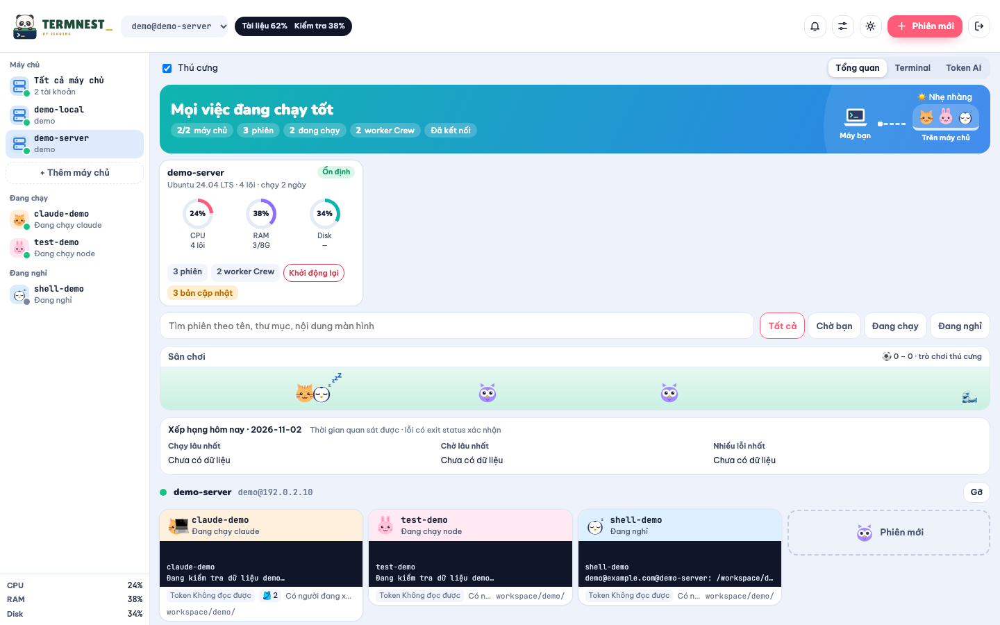

<h1 align="center">
  <picture>
    <source media="(prefers-color-scheme: dark)" srcset="docs/brand/termnest-logo-dark.svg">
    
  </picture>
</h1>

<p align="center">
  <strong>Every session has a home.</strong><br>
  Mọi phiên terminal trên mọi máy, gọn trong một cửa sổ.
</p>

<p align="center">
  <a href="../../releases/latest"></a>
  <a href="LICENSE"></a>
  
  <a href="../../stargazers"></a>
</p>

<p align="center">
  
</p>

Bạn chạy Claude Code trên máy chủ, build ở máy khác, rồi gập laptop đi họp. Quay lại là phải mở lại từng cửa sổ SSH và đoán xem phiên nào đang đợi mình.

**Termnest** gom hết các phiên tmux đó vào một cửa sổ. Nhìn là biết phiên nào đang chạy, phiên nào cần bạn trả lời. Đóng app hay mất mạng cũng không sao, phiên vẫn chạy tiếp.

## Tính năng

- 🪺 **Không mất phiên** khi đóng app, mất mạng hay đổi máy
- 🖥️ **Một cửa sổ cho nhiều máy**, cả máy bạn lẫn máy chủ SSH
- 🔔 **Báo khi phiên cần bạn** và trả lời ngay trên thẻ phiên
- 🤖 **Mở nhanh Claude Code, Codex**, xem lượng token đã dùng
- 🪟 **Chia 1, 2 hoặc 4 ô** terminal
- 📊 **Theo dõi CPU, RAM, ổ đĩa** từng máy
- 🇻🇳 **Gõ tiếng Việt** (Telex, VNI) ngay trong terminal
- 🐼 **Mỗi phiên một bạn thú cưng**, nhìn là biết trạng thái

## Cài đặt

Tải bản mới nhất ở **[Releases](../../releases/latest)**:

- macOS Apple Silicon: `Termnest-arm64.dmg`
- macOS Intel: `Termnest-x64.dmg`
- Windows 10/11: `Termnest-Setup.exe`

Cài thêm tmux để phiên được giữ lại: `brew install tmux` trên macOS, hoặc `sudo apt install tmux` trong WSL trên Windows.

> [!NOTE]
> Bản cài chưa được ký. Nếu macOS báo ứng dụng “bị hỏng”, chạy `xattr -cr /Applications/Termnest.app`. Nếu Windows hiện SmartScreen, chọn **More info → Run anyway**.

## Chạy từ mã nguồn

Cần Node.js 18 trở lên và tmux.

```bash
git clone https://github.com/jiaqing-l/termnest.git && cd termnest
npm install
npm run set-password
npm start   # mở http://127.0.0.1:7681
```

Muốn dùng từ xa thì mở qua SSH tunnel: `ssh -L 7681:127.0.0.1:7681 user@your-server`. Xem thêm [tài liệu hướng dẫn](docs/).

## Bảo mật

- **Termnest** chỉ chạy trên `127.0.0.1`, không mở cổng ra ngoài.
- Khóa SSH được mã hóa bằng mật khẩu **Termnest**. Mật khẩu máy chủ không bao giờ được lưu.
- Không thu thập dữ liệu. Mục Token AI chỉ gọi API của Anthropic bằng tài khoản Claude trên máy bạn để xem hạn mức.

Nếu phát hiện lỗ hổng, hãy báo riêng theo [hướng dẫn bảo mật](SECURITY.md).

## Đóng góp

Mọi góp ý, báo lỗi hay pull request đều đáng quý. Xem [hướng dẫn đóng góp](CONTRIBUTING.md) để bắt đầu.

Nếu thấy **Termnest** hữu ích, tặng dự án một ⭐ nhé!

## Giấy phép

**Termnest** dùng [Giấy phép MIT](LICENSE). Bạn có thể dùng, sửa và chia sẻ thoải mái, kể cả cho công việc, miễn là giữ lại thông báo bản quyền và nội dung giấy phép.

Tên **Termnest**, **JIAQING** và logo không thuộc phạm vi giấy phép. Nếu bạn phát hành bản sửa riêng, hãy đặt tên và dùng logo khác.

Phần mềm được cung cấp nguyên trạng, không kèm bảo đảm. Bạn tự chịu trách nhiệm về các lệnh chạy qua **Termnest**. **Termnest** là dự án độc lập, không liên quan đến tmux, Anthropic hay OpenAI.

## Cảm ơn

**Termnest** được xây dựng trên [tmux](https://github.com/tmux/tmux), [xterm.js](https://xtermjs.org), [node-pty](https://github.com/microsoft/node-pty), [ssh2](https://github.com/mscdex/ssh2) và [Tauri](https://tauri.app). Xem [danh sách đầy đủ các thư viện](THIRD-PARTY-NOTICES.md).

---

<p align="center"><sub>MIT © 2026 <b>JIAQING</b></sub></p>
