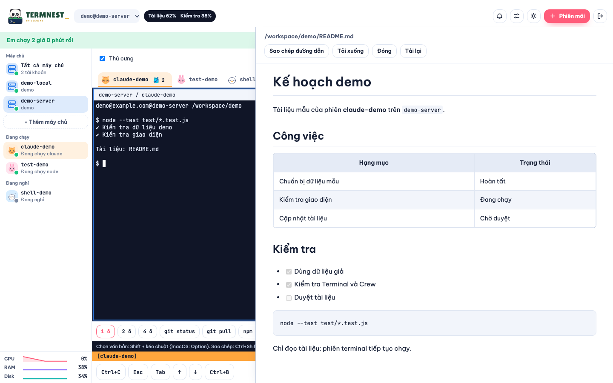

# Token AI và trình xem tệp

### Token AI và mở tệp trong terminal

- Token AI trả cache ngay (`updatedAt` là lần quét thành công; `null` khi chưa có kết quả). Lần mở đầu tiên có thể chờ tới lần poll tiếp theo để hiện số liệu. Trình duyệt poll mỗi 30 giây khi tab đang hiện và Token AI hoặc thanh mini đang hiển thị. Máy chủ chỉ bắt đầu quét khi có poll, cách nhau tối thiểu 60 giây; không có timer quét khi không dùng web.
- Quét và tổng hợp chạy trong worker riêng; mỗi lần chỉ một lượt, kể cả các tài khoản/SSH. Log không đổi không bị đọc lại. Cache giữ tổng theo ngày và phiên; Claude giữ thêm chỉ mục hash ID / số đếm để thay thế streaming snapshot và khử trùng log sao chép. Không giữ nội dung prompt hay raw event. SSH dò Node.js hoặc dùng Python 3.9+; credential vẫn nằm trên máy chứa tài khoản.
- Bấm đường dẫn như `Implementation/Foo/13-BAR.md` (kể cả xuống dòng mềm) để mở panel bên cạnh terminal. Đường dẫn tương đối dựa trên thư mục **hiện tại** của pane tmux; đường dẫn tuyệt đối phải nằm trong thư mục đó. `../` và symlink thoát thư mục bị chặn. Local PowerShell dùng thư mục khởi chạy của phiên.
- Panel có **Sao chép đường dẫn**, **Tải xuống**, **Tải lại**, **Đóng** và hỗ trợ Esc để đóng. Kéo cạnh trái (hoặc dùng phím mũi tên khi chọn cạnh) để đổi chiều rộng; trình duyệt nhớ chiều rộng nếu localStorage khả dụng. Đường dẫn rút gọn có tooltip đầy đủ. Chỉ nhận văn bản UTF-8 tối đa 5 MB. Markdown dùng markdown-it cài tại máy, hỗ trợ bảng, danh sách công việc và các khối Markdown; HTML thô được escape, liên kết mở tab mới và chặn URL javascript/data. Markdown được phân tích bằng Web Worker và chèn theo từng nhóm khối để giữ terminal phản hồi. Markdown/HTML xem đầy đủ tới 5 MB; văn bản khác xem tối đa 200.000 ký tự / 2.000 dòng và báo rõ nếu bị cắt. HTML chạy qua route xác thực riêng trong iframe `sandbox="allow-scripts"` không có `allow-same-origin`: CSS/script nội tuyến hoạt động; CSP chặn kết nối và tài nguyên ngoài tệp, có ghi chú ngay trên khung. Tải xuống chứa toàn bộ tệp.
- Khi tmux bắt chuột, giữ **Shift + kéo chuột** để chọn văn bản trên Linux/Windows; **Option + kéo chuột** trên macOS. Sao chép bằng **Ctrl+Shift+C** hoặc **⌘C**. Chọn văn bản không mở liên kết. Có nhắc phím tại chân terminal.

Thanh Token AI hiển thị một phần trăm cho mỗi tài khoản: phiên trước, tuần nếu thiếu phiên, `—` nếu chưa có quota. Token hôm nay nằm trong thẻ tài khoản.

Sân chơi có ba thú nhà khi ít hơn hai phiên idle; chúng cùng phiên idle chơi bóng, câu cá hoặc đi dạo theo timer ngẫu nhiên và ngủ 23:00–06:00. Công tắc Thú cưng và reduced motion vẫn áp dụng. Thẻ máy có kích thước đồng đều; macOS đọc CPU bằng `ps` (chuẩn hóa theo số lõi), RAM active + wired + compressed bằng `vm_stat` và `sysctl`. Thiếu số đo vẫn hiện `—`.
