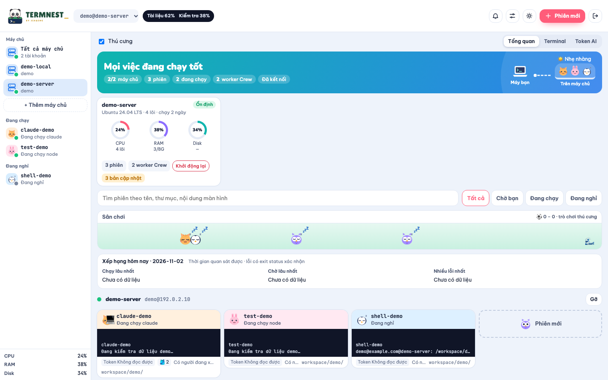
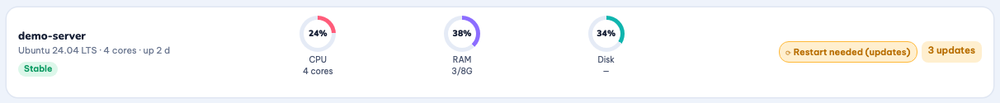
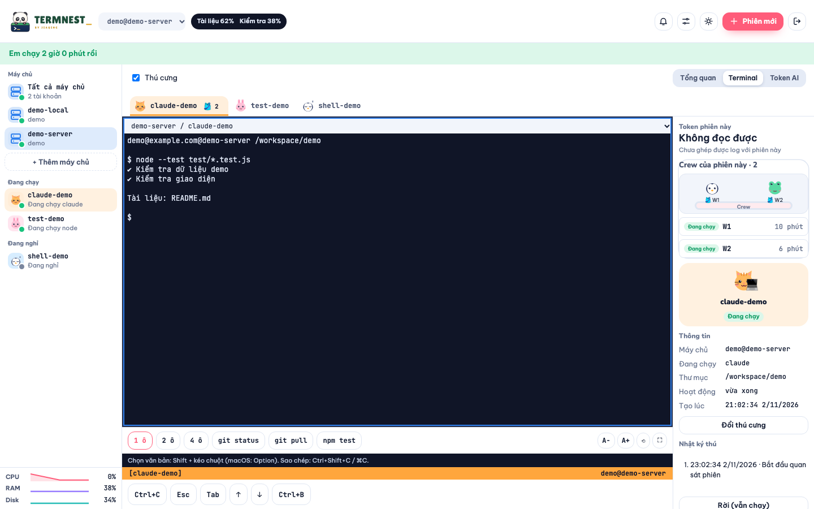

# Phiên và theo dõi máy chủ

## Tổng quan máy chủ

Chọn **Tất cả máy chủ** hoặc một máy trong đầu trang. Thẻ máy chủ có vòng CPU, RAM, Disk, tải một phút, swap, tốc độ mạng, tiến trình nặng và nhãn tình trạng. Viền và vòng đỏ cho biết tài nguyên vượt ngưỡng. Máy mất kết nối hiện thời gian mất kết nối. Bấm thẻ để xem chi tiết. Trên điện thoại, các hàng số liệu phụ được thu gọn.

## Thông báo khi chờ bạn

Mở **Cài đặt** ở đầu trang, bật thông báo trình duyệt rồi cho phép khi trình duyệt hỏi. Chỉ báo khi phiên mới chuyển sang **Chờ bạn**; phiên đã chờ khi vừa mở trang không phát thông báo. Bấm thông báo để vào phiên. Tiêu đề tab cũng hiện số phiên đang chờ.

Thông báo trình duyệt chỉ phát khi trang còn mở trong một tab. Trình duyệt không hỗ trợ hoặc từ chối quyền sẽ không phát thông báo.

## Trả lời nhanh

Trên thẻ **Chờ bạn**, đọc dòng cuối có nội dung của màn hình phiên, bấm **Yes** để gửi `y`, **No** để gửi `n`, hoặc nhập câu trả lời và bấm **Gửi** (cũng có thể nhấn Enter). Câu trả lời được gửi kèm Enter. Nội dung đang nhập được giữ khi số liệu cập nhật. Bấm phần khác của thẻ để vào terminal.

## Khôi phục phiên

Sau khi máy chủ khởi động lại, banner liệt kê phiên có thể khôi phục. Bấm **Khôi phục** để tạo lại; banner báo tên và lỗi của phiên chưa khôi phục được. Bấm **Bỏ qua** để bỏ danh sách này.

Danh sách phiên Máy này được lưu định kỳ (tối đa một phút khi không mở trang) trong `data/vault.json` đã mã hóa, trên chính máy chạy tool. Tạo/dừng/khôi phục qua web lưu ngay. Nhận biết lần khởi động qua boot ID Linux, `kern.boottime` trên Mac, thời điểm boot Windows; WSL còn kiểm tra boot ID riêng. Phiên PowerShell thường còn nhận biết lần khởi động lại tool.

**Cài đặt → Tự khôi phục phiên Máy này sau khi khởi động lại** mặc định tắt. Khi bật, sau lần đăng nhập mở khóa vault đầu tiên, tool thử tạo lại từng phiên một lần; phiên lỗi vẫn nằm ở banner để thử thủ công. Không khôi phục chương trình đang chạy dở.

Claude tiếp tục theo tên phiên + thư mục như trước. Với Codex local, tool kiểm tra `codex resume --help` trên backend được chọn; nếu hỗ trợ thì khôi phục mở **bộ chọn hội thoại** trong thư mục cũ để bạn chọn tiếp tục. Không tự dùng `--last`, vì nhiều phiên có thể dùng chung thư mục. Nếu không xác minh được lệnh resume (hoặc trên máy SSH), mở Codex mới tại thư mục cũ. Không lưu token AI hay đoán hội thoại từ tên phiên.

## Mẫu phiên và thư mục gần đây

Bấm **Phiên mới**, chọn máy chủ, tên, thư mục và cách mở. Bấm **Chọn** để duyệt thư mục trên máy chủ. Chọn một mẫu để điền tên, thư mục và cách mở; bấm dấu **×** cạnh mẫu để xóa. **Lưu làm mẫu** lưu các ô hiện tại. Thư mục gần đây được ghi lại sau khi tạo phiên thành công; bấm một thư mục để điền nhanh. Các khối này chỉ hiện khi có dữ liệu.

## Cảnh báo tài nguyên

Bấm chuông ở đầu trang để xem phiên chờ, tài nguyên vượt ngưỡng, máy mất kết nối, phiên có thể khôi phục và dịch vụ lỗi. Bấm một dòng để đi tới phiên hoặc máy tương ứng. Trong **Cài đặt**, kéo ngưỡng CPU, RAM, Disk; thay đổi tự lưu sau khi thả thanh trượt.

## Lệnh mẫu

Trong terminal, bấm lệnh phía trên hàng phím nhanh để gửi lệnh và Enter tới ô đang được chọn. Mở **Cài đặt → Lệnh mẫu** để thêm lệnh hoặc bấm **×** để xóa. Chỉ bấm lệnh khi đã chọn đúng phiên và thư mục làm việc.

## Tìm và lọc phiên

Trong **Tổng quan**, nhập tên phiên, đường dẫn hoặc nội dung màn hình vào ô tìm. Dùng **Tất cả**, **Chờ bạn**, **Đang chạy**, **Đang nghỉ** để lọc thêm. Bộ lọc áp dụng cho thẻ phiên và danh sách phiên bên trái, trong phạm vi máy chủ đã chọn.

## Lịch sử tài nguyên

Bấm thẻ máy chủ rồi chọn **1 giờ**, **6 giờ** hoặc **24 giờ**. Biểu đồ có CPU, RAM, Disk; bên dưới là ổ đĩa, tiến trình và tình trạng hệ thống. Mẫu cách nhau hơn ba phút được vẽ thành khoảng trống. Khi chưa đủ mẫu, cần chờ thêm.

Lịch sử, cảnh báo và khôi phục chỉ thu thập khi Termnest đang chạy và đã được mở khóa: sau khi web khởi động lại, phải có người đăng nhập một lần. Ngoài thời gian đó, lịch sử có khoảng trống. `data/history.json` lưu lịch sử tài nguyên và không được mã hóa. File này không chứa bí mật.

## Chia terminal

Trong terminal, chọn **1 ô**, **2 ô** hoặc **4 ô**. Mỗi ô là terminal riêng và có danh sách chọn phiên trong phạm vi máy chủ hiện tại. Bấm một ô để chọn; phím nhanh và lệnh mẫu tác động tới ô đó. Về **1 ô** sẽ giữ phiên đang chọn và đóng kết nối của các ô còn lại. Trên màn hình nhỏ chỉ có **1 ô**.

Dùng **A− / A+ / ⟲** để chỉnh hoặc đặt lại cỡ chữ terminal; log Crew có **A− / A+** riêng. Phím tắt **⌘ + / − / 0** trên macOS hoặc **Ctrl + / − / 0** trên Windows/Linux tăng, giảm hoặc đặt lại cỡ chữ (cũng nhận phím `=`); bấm/chọn popup Crew để áp dụng cho log. Có thể giữ **Ctrl** và cuộn chuột trên terminal hoặc log để đổi cỡ chữ. Cỡ chữ được lưu riêng cho terminal và Crew. Bấm **⛶**, **F11** hoặc **⌘/Ctrl+Shift+F** để bật/tắt toàn màn hình cho ô đang chọn; bấm **Thoát toàn màn hình** để trở lại. **Esc** vẫn dành cho terminal.

**Rời** giữ việc trên máy chủ chạy; **Dừng** kết thúc phiên sau khi xác nhận.

## Máy chủ khác

Tool chỉ cần cài trên một máy. Các máy khác chỉ cần SSH và tmux (`sudo apt install tmux`), rồi thêm trên web.

## Những điều cần biết

- **Thư mục mặc định** của Máy này là home của người dùng (home Linux trong WSL). Máy SSH giữ mặc định hiện có, hoặc dùng `$HOME` nếu thư mục đó không tồn tại. Đặt `TW_DEFAULT_DIR` để đổi mặc định của SSH.
- **Mở bằng Claude:** mỗi cặp tên phiên + thư mục thực có một cuộc trò chuyện riêng; tạo lại đúng cặp này sẽ mở lại cuộc trò chuyện đã lưu. Các cuộc trò chuyện không được tạo bằng tool này không được tìm theo tên.
- **Mật khẩu máy chủ** không được lưu. Web khởi động lại thì phải nhập lại. Khóa SSH thì tự kết nối lại.
- **Khóa SSH** được mã hóa trong `data/vault.json` bằng mật khẩu Termnest.
- **Quên mật khẩu Termnest:** không lấy lại được. Xóa `data/vault.json`, đặt mật khẩu mới rồi thêm lại máy chủ. Việc trên máy chủ không ảnh hưởng.
- **Chờ bạn** là phán đoán từ màn hình (câu hỏi y/n, hoặc Claude im hơn 20 giây), nên đôi khi có thể sai.
- **Crew** chỉ hiện worker đang chạy (`codex exec`, `claude --print`, `crew-dispatch.sh`), kèm 3 dòng log cuối nếu tìm thấy. Mục này chỉ để xem, worker xong thì mất khỏi danh sách.
- Máy chủ tắt hoặc khởi động lại thì phiên trên máy đó dừng.
