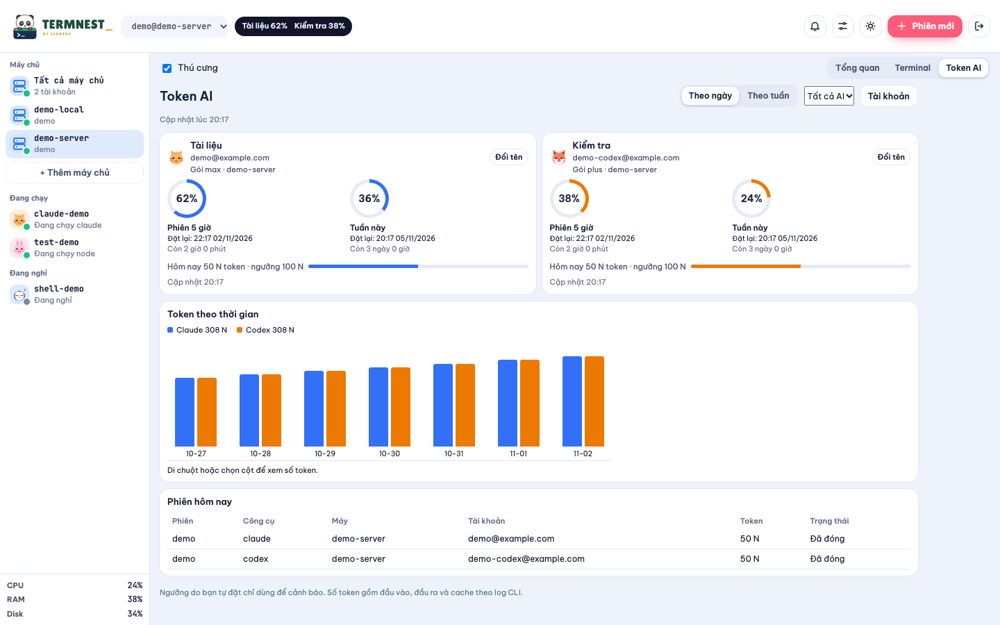

# Token AI

Vào **Token AI → Tài khoản** để khai báo thư mục cấu hình Claude hoặc Codex trên từng máy, đặt biệt danh và ngưỡng cảnh báo token mỗi ngày. Đường dẫn được xử lý trên máy đã chọn; cấu hình được lưu trong prefs mã hóa. Tự tìm `~/.claude`, `~/.claude-*`, `~/.codex`, `CLAUDE_CONFIG_DIR` và `CODEX_HOME`; mục khai báo thủ công được ưu tiên khi trùng thư mục thực, không che tài khoản khác.

Đọc usage từ Claude `projects/**/*.jsonl` và sự kiện `token_count` trong Codex `sessions/**/*.jsonl`. Claude tính cả cache input, khử trùng message ID; Codex lấy chênh lệch bộ đếm tích lũy, không cộng cache hai lần. Chỉ đọc dòng hoàn chỉnh mới thêm; log bị xoay/cắt sẽ làm mất hiệu lực cache. Dòng lỗi được bỏ qua và báo số lượng, không bỏ tổng hợp hợp lệ. Ngày/tuần theo múi giờ trình duyệt, tuần bắt đầu thứ Hai.

Danh tính Claude lấy từ `.claude.json` (profile mặc định dùng `~/.claude.json`); Codex chỉ đọc các claim cho phép từ ID token trong `auth.json`. Metadata gói Claude chỉ lấy trường cho phép từ phản hồi CLI tạm thời.

Quota Claude dùng OAuth `/api/oauth/usage`, timeout 5 giây. Đọc credential từ `.credentials.json` của profile hoặc macOS Keychain (`Claude Code-credentials`, profile riêng thêm 8 ký tự đầu SHA-256 của đường dẫn tuyệt đối). Profile riêng không mượn credential mặc định. Phân biệt hết hạn, từ chối, giới hạn tần suất và lỗi mạng; chờ ít nhất 5 phút trước khi thử lại khi lỗi, giữ quota thành công gần nhất kèm thời điểm. Codex dùng `window_minutes` của sự kiện mới nhất; mỗi cửa sổ được xử lý riêng, qua mốc reset hiện 0 và **Đã đặt lại**, thiếu dữ liệu hiện không đọc được. Ngưỡng mỗi ngày do người dùng đặt không phải hạn mức nhà cung cấp.

Máy SSH đọc bằng user kết nối, không sudo: tìm Node trong PATH, Homebrew, Volta, nvm; dự phòng Python 3.9+ có zoneinfo. Cache thư mục riêng chỉ chứa usage đã làm sạch, ID băm và quota, không chứa token đăng nhập, prompt hoặc log thô. Máy thiếu dữ liệu chỉ hiện một dòng trạng thái.

Tổng hợp hiển thị lưu tại `TW_DATA/token-aggregates.json` với quyền 0600, hiện ngay sau khởi động trong lúc worker cập nhật. Node đọc tăng dần, Python đọc lại file khi thay đổi. Web poll mỗi 30 giây (5 giây ở lần quét đầu); quota Claude thành công được làm mới tối đa một lần/phút. Chỉ một worker chạy, có TTL và giới hạn thời gian từng nguồn. Xem thêm [cache và xuất dữ liệu](file-viewer.md).

Số liệu ở chân/chi tiết phiên cần liên kết chính xác với log: Claude do Termnest mở dùng UUID xác định từ thư mục thực và tên phiên; `codex resume <UUID>` liên kết tường minh. Các log khác vẫn xuất hiện ở bảng Token AI, nhưng thẻ phiên hiện **Không đọc được**; không đoán từ tên tiến trình hoặc thư mục. Log lịch sử không chứng minh chương trình đang chạy.

Bộ kiểm thử dùng dữ liệu giả và không gọi nhà cung cấp. Xem [hướng dẫn kiểm thử](development.md).
